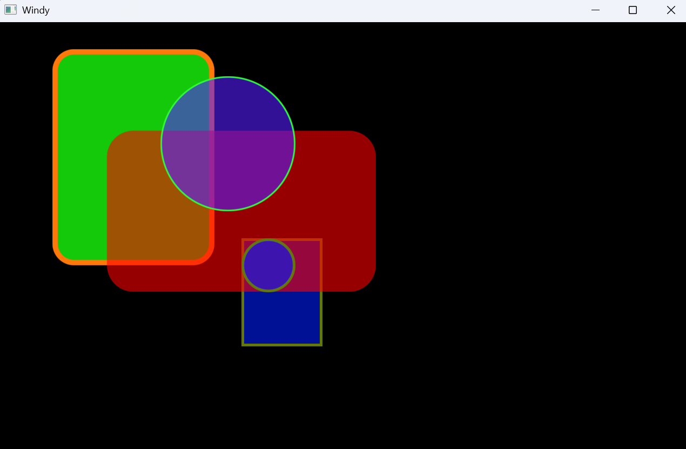

# Proof of Concept: "Layer of stacks" - Group Rendering and Painting 

This is an experiment and a try to create a base for Rendering and Drawing of Objects like Rectangle or Text in Nim.

The idea is to use Group Rendering for areas on a screen to reduce rendering and upload to the GPU.

There is no roadmap and no plan for development. It is a learning project to understand the complexity of an Retained UI Framework.

## Tier 1 - Some aspects for Rendering/Drawing:

- [x] Use only primitive GPU-Objects (traingles) for Rectangle, Circle.
- [ ] Text/Fonts rendering (as Texture?) - Max texturebuffer GL=32, GLES=16 for one upload to GPU.
- [x] Transfer as much as possible from CPU to GPU.
- [ ] Low CPU and GPU power consuming on runtime.  
  - [x] Rectangle, Circle
  - [ ] Text/Fonsts
- [x] Antialiazing of RenderObjects without hardware antialization (MSAA = MultiSampling Anti-Aliasing).
- [x] Reduce single Uploads from CPU to GPU. (Group Rendering/Drawing)
- [x] Simple and readable design and coding (no templates, no macros, no DSL). Nim offers in this case a lot of.
- [ ]Rendering of areas with caching.
- [ ]Event Loop on main thread.
- [ ]Rendering on separate thread.

Some ideas come from an earlier experiment about "Group Rendering":
https://github.com/fyne-io/fyne/issues/3412#issuecomment-1646863204

If the performance tests are successful Tier 2 in another package could follow.

## Tier 2 - Some aspects for Retained-Mode UI FW:

- [ ] Imperative design.
- [ ] Events with callbacks.
- [ ] Simple layout system. (only columns and rows)
- [ ] Bare minimum Widgets/Controls.
- [ ] Check, if "Relays" fit for Retained-Mode (https://github.com/nim-lang/uirelays).
- [ ] ...

## Example

`src/main.nim` is an example or a test file.

Windy  
`nimble install https://github.com/treeform/windy`  
`nim.exe c -d:WindyGl -d:release .\src\main.nim`  
GLFW  
`nimble install https://github.com/RowDaBoat/nglfw`   
`nim.exe c -d:GlfwGL -d:release .\src\main.ni`  

